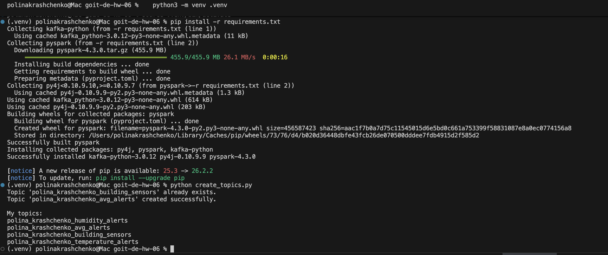
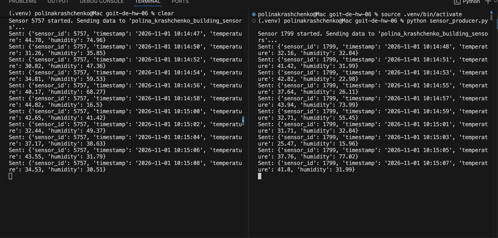
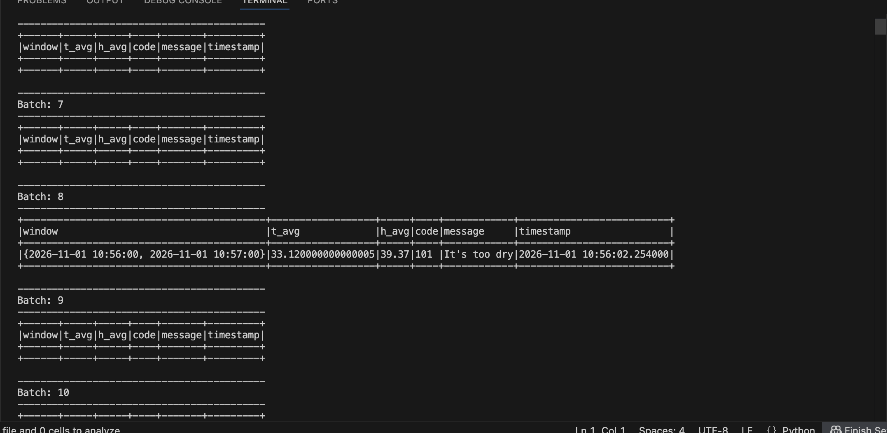
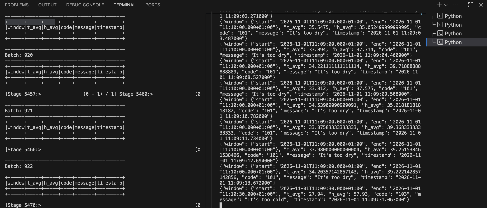

# goit-de-hw-06 — Spark Structured Streaming + Kafka

Моніторинг IoT-датчиків: Spark читає потік даних із Kafka, рахує середні температуру
й вологість у ковзному вікні та записує алерти у вихідний Kafka-топік.

## Топіки

| Топік | Призначення |
|---|---|
| `polina_krashchenko_building_sensors` | вхідні дані датчиків (як у ДЗ5) |
| `polina_krashchenko_avg_alerts` | алерти за середніми значеннями |

## Файли

| Файл | Що робить |
|---|---|
| `configs.py` | параметри підключення до Kafka та імена топіків |
| `create_topics.py` | створює вхідний і вихідний топіки |
| `sensor_producer.py` | 1. генерація даних одного датчика (запускати кілька разів) |
| `alerts_conditions.csv` | умови алертів (`-999` — межа не використовується) |
| `alerts_streaming.py` | 2–5. Spark Streaming: агрегація, cross join з умовами, фільтрація, запис у Kafka |
| `alerts_consumer.py` | читає вихідний топік і виводить алерти (для перевірки) |

## Логіка

1. **Вхідний потік** — `readStream` з Kafka, JSON розбирається за схемою `sensor_id, timestamp, temperature, humidity`.
2. **Агрегація** — `window(timestamp, "1 minute", "30 seconds")` з `withWatermark("timestamp", "10 seconds")`, середні `t_avg` і `h_avg`.
3. **Умови** — `alerts_conditions.csv` читається як звичайний DataFrame, тож критерії можна змінювати без зміни коду.
4. **Алерти** — `crossJoin` середніх значень з умовами і фільтр: значення має бути між `min` і `max`, межа `-999` ігнорується.
5. **Запис** — `writeStream.format("kafka")` у `avg_alerts` (для наочності ті самі алерти виводяться в консоль).

Приклад повідомлення у вихідному топіку:

```json
{"window": {"start": "2026-11-01T10:00:30.000+01:00", "end": "2026-11-01T10:01:30.000+01:00"},
 "t_avg": 41.52, "h_avg": 37.18, "code": "104", "message": "It's too hot",
 "timestamp": "2026-11-01 10:01:12.345678"}
```

## Запуск

Потрібні Java 17 і Python 3.

```bash
python3 -m venv .venv
source .venv/bin/activate
pip install -r requirements.txt

python create_topics.py        # один раз
python sensor_producer.py      # термінал 1 — датчик №1
python sensor_producer.py      # термінал 2 — датчик №2
python alerts_streaming.py     # термінал 3 — Spark Streaming
python alerts_consumer.py      # термінал 4 — перевірка вихідного топіка
```

## Скриншоти

### Створення топіків


### 1. Генерація даних: два датчики працюють одночасно (ID 5757 і 1799)


### 2. Spark Streaming: середні значення у вікні та знайдений алерт


### 3. Відфільтровані алерти записані у вихідний топік
Зліва Spark Streaming, справа повідомлення, прочитані з `polina_krashchenko_avg_alerts`.

